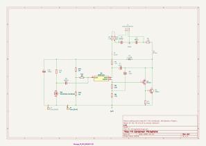
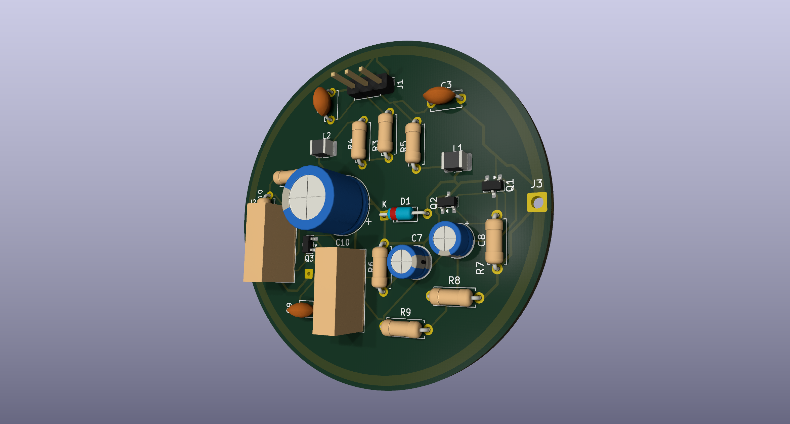
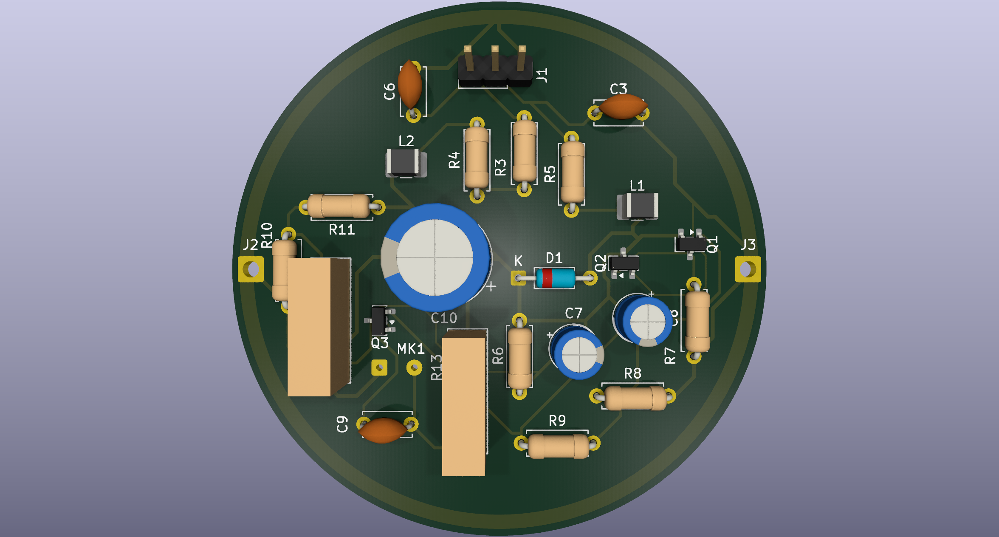
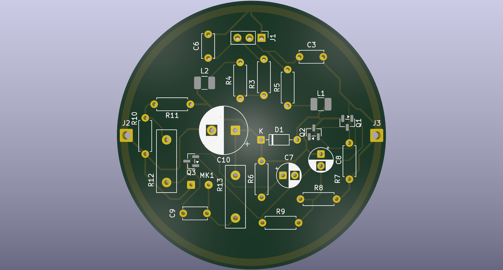
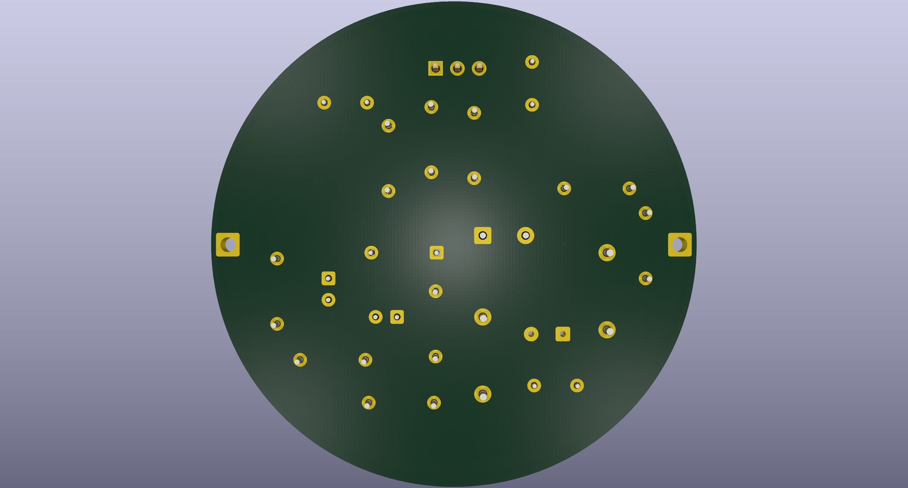
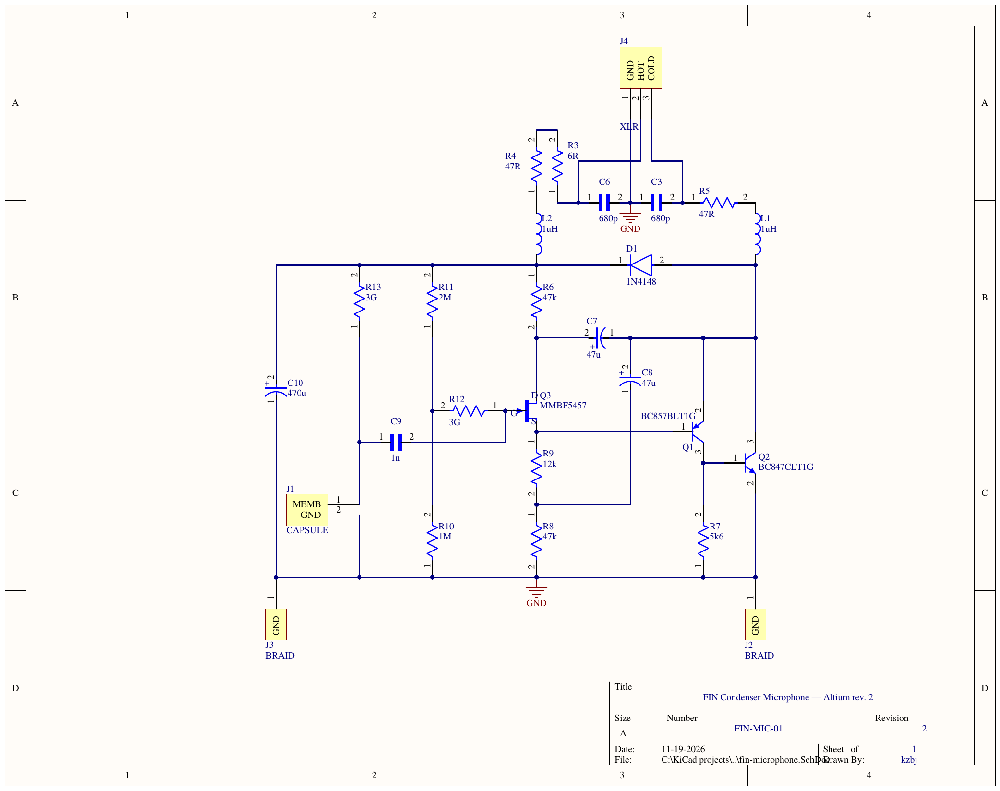
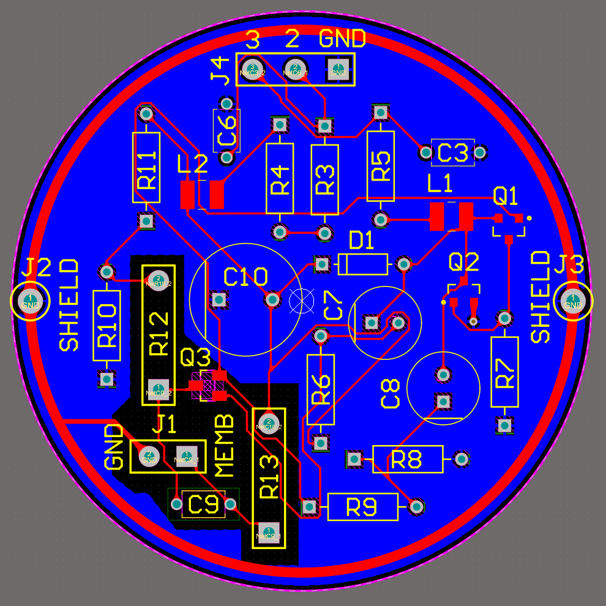
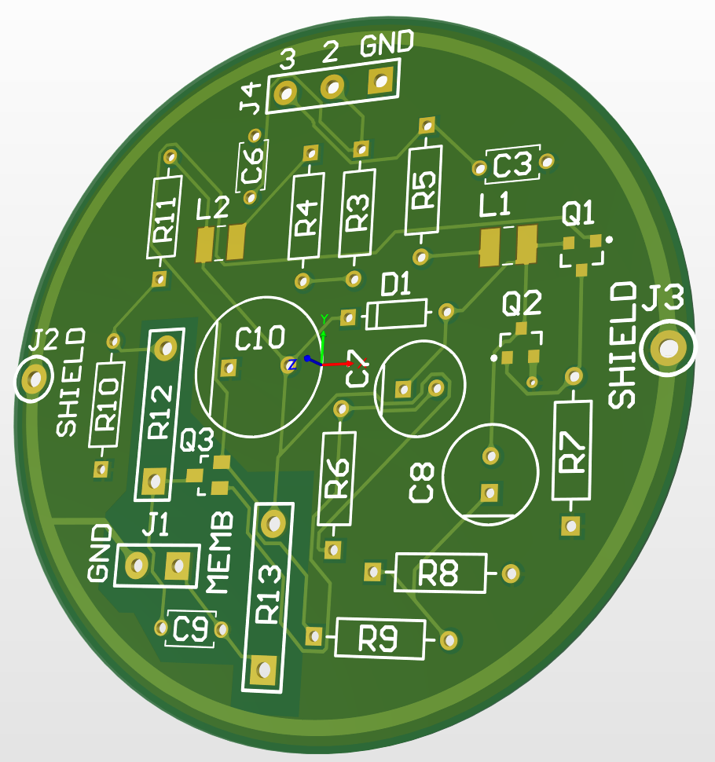
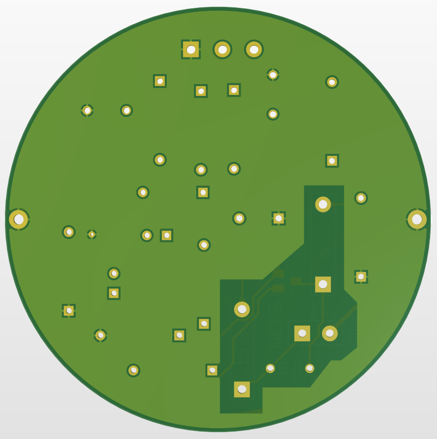

# DIY FIN Condenser Microphone

A DIY studio condenser microphone based on the **FIN circuit**: a transformerless, phantom-powered (48V) design with a JFET input stage and an XLR output.

This repository contains my schematic and PCB in two versions (KiCad and Altium Designer), the Bill of Materials (BOM), sourcing notes (including local options in Prague), and build progress notes.

---

## Project Status

**Current status:** in progress

- [x] Schematic redrawn in KiCad
- [x] BOM compiled
- [x] PCB laid out in KiCad (DRC clean)
- [x] Schematic and PCB redrawn in Altium Designer — rev. 2 (DRC clean, 0 violations)
- [ ] Verify open questions against the original schematic (see below)
- [ ] Check custom footprints against real parts (1:1 printout)
- [ ] Order PCB
- [ ] Buy a replacement capsule
- [ ] Source special components (3GΩ resistors, JFET, inductors)
- [ ] Assemble and test
- [ ] Design an enclosure

Not all components are available off the shelf in local stores (e.g. 3GΩ resistors, the JFET, the inductors), so I document substitutes and sourcing workarounds as I go.

---

## Background

The project is based on a YouTube Short by **[Alexey Kostrykin](https://www.youtube.com/@AlexeyKostrykin/shorts)**, *["Микрофон по схеме FIN"](https://www.youtube.com/shorts/0v5QWER9Aq8)*, where the voiceover is recorded with the microphone itself.

The author published a **[Google Drive folder](https://drive.google.com/drive/folders/1b-6JGVSPCHNgb5s343AQEgBrW2yjJV4H?usp=drive_link)** with schematics, PCB layouts, test recordings and assembly notes. This repository documents my own build: redrawing the circuit in KiCad and Altium Designer, designing my own PCB, sourcing parts and substituting obsolete components.

---

## Schematic

## PCB

| Top | Bare board | Bottom |
|---|---|---|
|  |  |  |

My own PCB design, made from scratch rather than copied from the original layout, because I use a different capsule. Designed in KiCad 10: round board, all components on one side, single-layer (F.Cu) routing.

- **Capsule and XLR are wired, not board-mounted:** both connect to solder-wire pads on the board (capsule: 2 pads, XLR: 3 pads).
- **Ground ring** around the board edge (net `Earth`).
- **Two solder pads on the ring (J2, J3)** for shielded/braided wire connecting PCB ground to the metal body.
- **Layout zones:**
  - capsule and JFET gate node (MK1, R13, C9, R12, Q3, R10, R11), with short traces and no copper pour nearby because of the gigaohm impedance;
  - amplifier / output stage (Q1, Q2, R6–R9, C7, C8, C10, D1);
  - RF filter next to the XLR pads (R3, R4, R5, C3, C6, L1, L2).

---

## Altium Designer version (rev. 2)

The `altium/` folder contains a second, revised version of the project, redrawn from scratch in **Altium Designer** (schematic and PCB). I made it to learn Altium and to correct and improve the KiCad design. Designators are the same as in the KiCad version.

### Schematic (Altium)

Full-resolution PDF: [schematics/fin-microphone-altium.pdf](schematics/fin-microphone-altium.pdf)

### PCB (Altium)

| 2D layout | 3D top | 3D bottom (GND pour) |
|---|---|---|
|  |  |  |

### Changes compared to the KiCad version

- **Board area changed:** the round board outline was resized.
- **Components selected against real parts:** every part was checked against an actual manufacturer part number (see the table below), not a generic footprint.
- **Ground pour inside the board:** a GND copper pour on the bottom layer, in addition to the ground ring around the edge.
- **Via added** for the ground connection between layers.
- **No copper around the gigaohm node:** the pour is cut out around the capsule and JFET gate area (J1, R12, R13, C9, Q3 gate) to avoid leakage and noise.
- **Custom symbols and footprints:** several parts had no ready-made models, so I drew my own:
  - 3GΩ resistor (radial SM102 body);
  - capsule (2 wire pads), XLR (3 wire pads), braid/ground (1 pad).
- **Component models from SnapMagic:** symbols and footprints for the transistors, JFET, inductors and capacitors were found on SnapMagic and imported into Altium.

### Parts used in the Altium version

| Ref | Part | Notes |
|---|---|---|
| Q3 | MMBF5457 | JFET, SOT-23 |
| Q1 | BC857B | PNP, SOT-23 |
| Q2 | BC847C | NPN, SOT-23 |
| L1, L2 | BRL3225T1R0M | 1.0µH, 1210 SMD |
| C3, C6 | FG28C0G2A681JNT00 | 680pF C0G, 100V, 5mm pitch |
| R12, R13 | 3GΩ, SM102-type body | custom footprint |

### Files

- `altium/fin-microphone.PrjPcb`: project
- `altium/fin-microphone.SchDoc`: schematic
- `altium/fin-microphone.PcbDoc`: PCB
- `altium/fin-microphone.SchLib`, `altium/fin-microphone.PcbLib`: custom symbols and footprints
- `altium/libs/`: imported component libraries

---

## Bill of Materials (BOM)

### 1. Capsule

The original 26mm capsule (ordered from China) never arrived after about three months, so I am switching to a **34mm capsule**.

- **Planned:** K47-type, single backplate, 2 terminals (sold as "RK-47" / "K47 capsule"), about 20–30 EUR.
- **Why K47 rather than K67:** K67-type capsules have a high-frequency lift that is meant to be corrected by the U67/U87 circuit. This circuit has no such correction, so a K67 would sound bright. A dual-diaphragm K67 still works if only the front diaphragm is connected.
- **Status:** not purchased yet.

### 2. Standard Components (GM Electronic, Prague)

| # | Component | Value / Part | Qty | Notes |
|---|---|---|---|---|
| 1 | Resistor | 47Ω | 2x | Metal film 0.6W 1%, THT |
| 2 | Resistor | 47kΩ | 2x | Metal film 0.6W 1%, THT |
| 3 | Resistor | 2MΩ | 1x | Metal film 0.6W 1%, THT |
| 4 | Resistor | 1MΩ | 1x | Metal film 0.6W 1%, THT |
| 5 | Resistor | 6R (see open questions) | 1x | Metal film 0.6W 1%, THT |
| 6 | Resistor | 12kΩ | 1x | Metal film 0.6W 1%, THT |
| 7 | Resistor | 5.6kΩ | 1x | Metal film 0.6W 1%, THT |
| 8 | Capacitor | 47µF | 2x | Electrolytic, 25–50V |
| 9 | Capacitor | 470µF | 1x | Electrolytic, 25–50V |
| 10 | Capacitor | 680pF | 2x | Film / ceramic, 5mm pitch |
| 11 | Capacitor | 1000pF (1nF) | 1x | Film / ceramic, 5mm pitch |
| 12 | Transistor | BC857B | 1x | PNP, SOT-23 |
| 13 | Transistor | BC847C | 1x | NPN, SOT-23 |
| 14 | Diode | 1N4148 | 1x | DO-35 THT (PCB uses the THT footprint; LL4148 is the SMD equivalent) |
| 15 | Connector | XLR male, 3-pin | 1x | Panel mount, wired to the PCB |

### 3. Special Components (Mouser / TME)

| Component | Value / Part | Qty | Notes |
|---|---|---|---|
| Resistor | 3GΩ | 2x | Capsule polarization and gate bias; rare value, alternatives: 3x 1GΩ in series or the nearest available value (exact value is not critical) |
| Inductor | 0.7µH | 2x | SMD, RF filter |
| JFET | MMBF5457 | 1x | SOT-23, soldered directly to the PCB; SMD replacement for the obsolete 2N5457 (TO-92) |

---

## Open Questions

To verify against the original schematic before ordering the PCB:

1. **R3 value:** it reads as 6R (6Ω) on my copy, but it may be 6.8kΩ. The original photo is ambiguous.
2. **R3 / R4 connection** at XLR pin 2: pin 3 has no matching resistor next to its 680pF capacitor, so this needs checking.
3. **D1 polarity:** in my schematic, the D1 anode is connected to the supply rail (C10 +). Check the direction against the original.

---

## Sourcing Notes (Prague, Czech Republic)

- **GM Electronic** (Křižíkova 147/77, Prague 8): local pick-up for standard passives, the XLR connector, BC transistors and the diode.
- **Mouser / TME:** online orders for the 3GΩ resistors, MMBF5457 and inductors.
- **eBay / AliExpress:** capsule. After the first order was lost, I plan to order from high-rated sellers with tracking, possibly from two sellers in parallel.

---

## Repository Structure

- `/kicad`: my KiCad project (schematic and PCB)
- `/altium`: my Altium Designer project, rev. 2 (schematic, PCB, custom libraries)
- `/schematics`: schematic exported from KiCad (SVG/PDF); the original FIN files are in the author's Google Drive (link above)
- `/photos`: build progress and photos of the finished microphone
- `/docs`: datasheets and notes on workarounds
